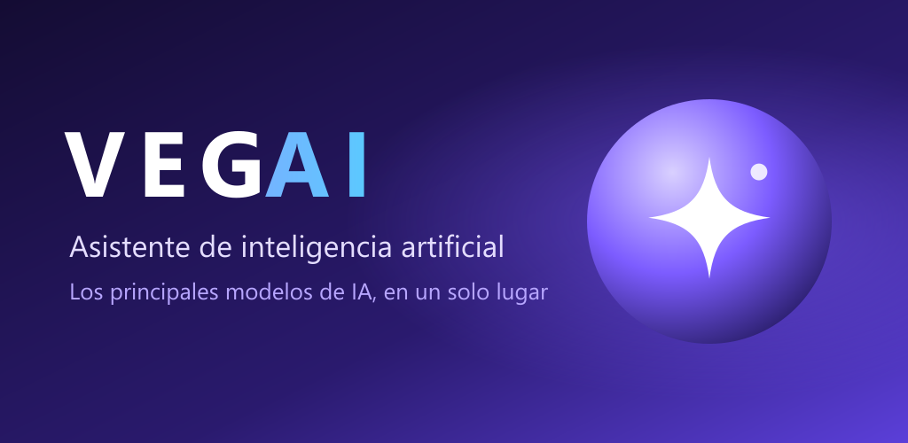
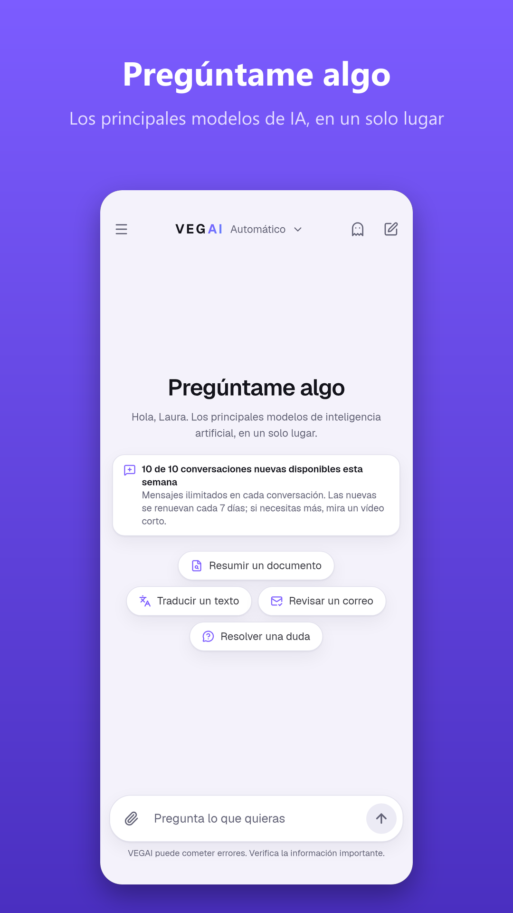
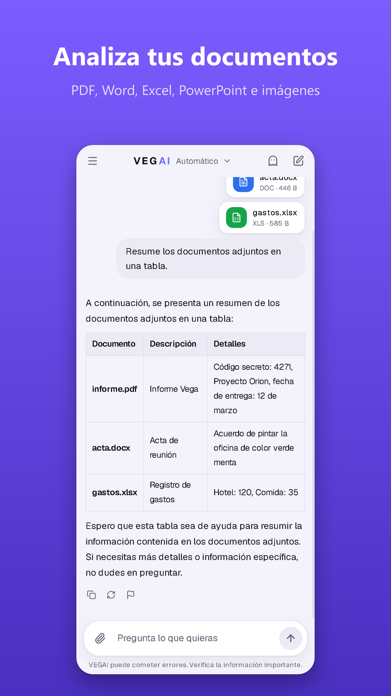
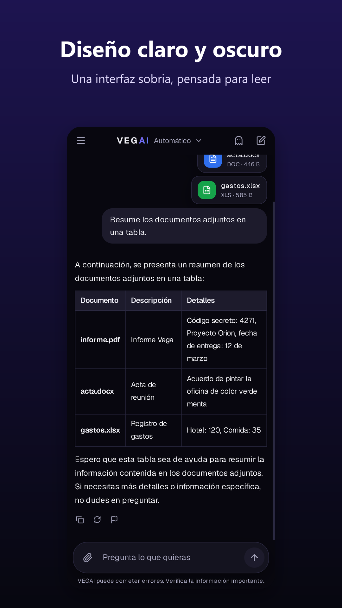
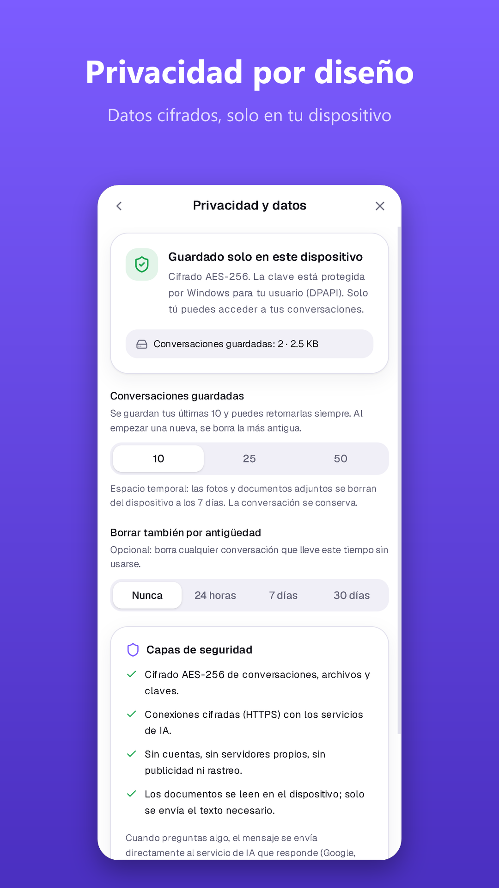

  

<h1 align="center">
   VEGAI
</h1>

<h3 align="center">Una sola app. Los mejores modelos de IA. Tus datos, solo en tu dispositivo.</h3>

  
  
  

  <a href="../../releases/latest"><b>⬇️ Descargar VEGAI</b></a> &nbsp;·&nbsp;
  <a href="#-lo-que-la-hace-diferente">Qué la hace diferente</a> &nbsp;·&nbsp;
  <a href="#-por-dentro">Cómo está hecha</a>

---

Imagina tener a **Qwen, GPT-OSS, Llama y Mistral trabajando para ti en la misma conversación**, sin crear ninguna cuenta, sin pagar suscripciones y sin que tus mensajes se queden guardados en el servidor de nadie.

Eso es **VEGAI**: un asistente de IA que se abre en un segundo, te llama por tu nombre, lee tus documentos, entiende tus fotos y elige en cada momento el mejor modelo disponible. Si uno se satura o falla, **otro toma el relevo al instante**, sin que tengas que hacer nada.

<table>
  <tr>
    <td align="center" width="33%">
      <h3>🧠 Varios cerebros en uno</h3>
      <b>26 modelos</b> (13 listos sin cuenta) orquestados por un enrutador propio que pondera calidad y velocidad en cada pregunta.
    </td>
    <td align="center" width="33%">
      <h3>🔒 Privada por diseño</h3>
      Sin cuentas. Conversaciones cifradas con AES-256 que <b>nunca salen de tu móvil</b> salvo hacia la IA que responde.
    </td>
    <td align="center" width="33%">
      <h3>⚡ Ligera y rapidísima</h3>
      4,5 MB en Android. Respuestas en tiempo real y modelos europeos que contestan en menos de un segundo.
    </td>
  </tr>
</table>

> **💬 Escribe todo lo que quieras.** Dentro de cada conversación **no hay límite de mensajes** y VEGAI **lo recuerda todo desde el primer mensaje**, aunque la conversación tenga miles: tiene memoria a largo plazo propia de cada chat. La conversación queda guardada para retomarla cuando quieras, hoy o dentro de un mes, hasta que tú decidas borrarla.
> El único límite es al **empezar** conversaciones nuevas: 10 por semana, y si necesitas otra, basta con ver un vídeo corto.

## 📱 Así se ve

| Pregúntame algo | Lee tus documentos | Modo oscuro | Tus datos, bajo control |
|---|---|---|---|
|  |  |  |  |

## 💡 Para qué la vas a usar

- **«Resúmeme este PDF de 40 páginas»**: adjunta el informe, el contrato o los apuntes y obtén lo importante en segundos, en tablas si lo pides.
- **«Revisa este correo antes de enviarlo»**: tono, faltas y claridad, con la versión corregida lista para copiar.
- **«Tradúcelo al inglés»**: textos, mensajes o documentos completos, en segundos.
- **«¿Qué pone en esta foto?»**: un ticket, una pizarra, una etiqueta o una captura de pantalla.
- **«¿Qué tiempo hará mañana en Sevilla?»**: previsión real, hora a hora y por días.
- **«Cuéntame las noticias de hoy»**: un resumen tipo telediario de los grandes medios, agrupado por temas y con el enlace a cada noticia.
- **Resolver dudas al momento**: de cocina a programación, de matemáticas a trámites. Con atajos de consulta rápida en la pantalla de inicio.

## ✨ Lo que la hace diferente

| | Apps de IA habituales | **VEGAI** |
|---|---|---|
| Cuenta para empezar | Normalmente obligatoria | **Ninguna: escribe tu nombre y listo** |
| Dónde viven tus chats | En los servidores del proveedor | **Solo en tu dispositivo, cifrados** |
| Modelos | Uno, el de la empresa | **26, con cambio automático** |
| Mensajes en el plan gratuito | Suelen estar limitados | **Ilimitados en cada conversación** |
| Si el servicio se satura | Esperas o pagas | **Otro modelo responde al instante** |
| Precio | Suscripción mensual | **Gratis** |

### 🧠 Un enrutador inteligente, no un simple chat
Cada pregunta pasa por un **motor de enrutado propio** que puntúa los modelos por inteligencia y velocidad, reparte los intentos entre proveedores y aprende de los fallos. Si un modelo alcanza su límite, solo ese modelo descansa: el resto sigue trabajando. Si algo falla a mitad de una respuesta, VEGAI la vuelve a generar con otro modelo automáticamente.

### 🔒 Privacidad que se puede demostrar
- **Cifrado AES-256-GCM** de conversaciones, archivos y claves, con la llave guardada en el **Android Keystore** o en **Windows DPAPI**.
- **Sin cuentas, sin servidores propios, sin analítica.** Tus conversaciones no se venden ni se comparten con anunciantes.
- **Chat temporal** 👻 que no deja rastro, **bloqueo con huella o cara** y **bloqueo de capturas de pantalla**.
- **Limpieza automática**: las fotos y documentos adjuntos se borran solos a los 7 días; se conservan tus **20 conversaciones más recientes** y, al empezar una nueva con la cola llena, la más antigua se borra sola (con aviso previo).
- Modelos principales alojados en **OVHcloud, en la Unión Europea**.

### 🌦️ El tiempo y la actualidad, al minuto
Los modelos de IA no saben qué pasa hoy, así que **VEGAI lo consulta por ellos**: cuando preguntas por el tiempo, obtiene la previsión real del **Instituto Meteorológico de Noruega (MET Norway)** para cualquier lugar del mundo; cuando preguntas por las noticias, reúne los titulares de las últimas horas de los grandes medios a través de **GDELT** y te los resume como un informativo, con el enlace a cada noticia. Sin inventarse nada: si no hay datos, te lo dice.

### 📄 Entiende tus archivos de verdad
PDF, Word, Excel, PowerPoint, OpenDocument, CSV, JSON y código fuente. El texto se extrae **en el propio dispositivo** y la IA lo analiza junto a tu pregunta. También admite fotos, arrastrar archivos y pegar desde el portapapeles.

### 💬 Conversaciones sin límite que lo recuerdan todo
Dentro de una conversación puedes escribir **todos los mensajes que quieras**: VEGAI mantiene el contexto de principio a fin y recuerda cada cosa que le has contado, incluidos los documentos y fotos que hayas compartido. Cada conversación **se guarda** y la retomas justo donde la dejaste, cuando quieras.

**Memoria a largo plazo por conversación.** Cuando un chat se vuelve muy largo, VEGAI condensa por su cuenta lo más antiguo (datos que le diste, decisiones, cifras, nombres y conclusiones) en una memoria cifrada que acompaña a esa conversación. Así recuerda desde el primer mensaje, sin importar cuánto hayáis hablado. Cada conversación tiene su propia memoria: lo que cuentas en una no se mezcla con las demás, y se borra en cuanto borras el chat.

Además, VEGAI te llama por tu nombre y **titula y resume automáticamente cada chat**, para que encuentres cualquier tema en el historial de un vistazo.

### 📶 Funciona aunque se vaya la cobertura
Sin conexión, VEGAI te lo indica y **guarda lo que escribas como pendiente**, cifrado en el dispositivo, para enviarlo solo en cuanto vuelva internet. Y mientras responde, puedes **dejar hasta 2 mensajes en cola** o **cortar la respuesta** con un toque.

### 🎨 Diseñada para gustar
Interfaz de **cristal esmerilado (glassmorphism)**, modo claro y oscuro, cinco colores de acento, **transiciones fluidas** entre pantallas y un diseño que se adapta igual de bien a un móvil, una tableta o un monitor de escritorio. En móviles modestos activa sola un modo ligero.

### 🖥️ En Windows, además, para profesionales
La versión de escritorio se instala con un clic, se abre como **aplicación propia (no en el navegador)** y trae un servidor integrado con una **API local compatible con OpenAI**, lista para conectar herramientas de programación, y la opción de **usar tu PC como motor de IA de tu móvil** en la red de casa.

## 🛠️ Por dentro

<table>
  <tr><td><b>Interfaz</b></td><td>React 19 · TypeScript · Vite 8 · Tailwind CSS 4</td></tr>
  <tr><td><b>Android</b></td><td>Capacitor 8 (API 36) con plugins nativos en Java: streaming HTTP, Keystore + biometría y tematizado de las barras del sistema. Compilado con R8: <b>4,5 MB</b></td></tr>
  <tr><td><b>Windows</b></td><td>Electron 38 con motor de enrutado integrado e instalador NSIS de un clic</td></tr>
  <tr><td><b>Seguridad</b></td><td>AES-256-GCM (WebCrypto) sobre IndexedDB · Android Keystore · Windows DPAPI · BiometricPrompt</td></tr>
  <tr><td><b>Documentos</b></td><td>pdf.js · fflate (Office/ODF) · todo procesado en el dispositivo</td></tr>
  <tr><td><b>IA</b></td><td>Enrutador multi-proveedor con puntuación, failover en streaming y pausas por modelo · OVHcloud AI Endpoints · Kilo Gateway · OpenRouter · Ollama Cloud</td></tr>
  <tr><td><b>Negocio</b></td><td>Google AdMob (banner, nativo y vídeo bonificado) con consentimiento RGPD · cumple la política de contenido generado por IA de Google Play</td></tr>
</table>

## ⬇️ Descargas

| Plataforma | Dónde |
|---|---|
| **Android** | Google Play *(muy pronto)* · APK en [Releases](../../releases/latest) |
| **Windows 10/11** | Instalador de un clic en [Releases](../../releases/latest) |

**Gratis.** Mensajes **ilimitados** dentro de cada conversación, con el contexto siempre guardado. Puedes empezar 10 conversaciones nuevas cada semana; ¿necesitas otra? Basta con ver un vídeo corto.

## 🙌 Créditos

- **Desarrollo y publicación:** ROMER Interactive
- **Código:** Pedro Antonio Ruiz Romero
- Construida sobre **[FreeLLMAPI](https://github.com/tashfeenahmed/freellmapi)** de **Tashfeen Ahmed** (licencia MIT).
- Los modelos de IA pertenecen a sus autores y se usan bajo sus licencias (Qwen, GPT-OSS y Mistral: Apache 2.0; Llama 3.3: Llama 3.3 Community License — *Built with Llama*).

---

  <a href="https://sites.google.com/view/vegai-privacidad">Política de privacidad</a> · <a href="mailto:romerinteractive@gmail.com">romerinteractive@gmail.com</a>

© 2026 ROMER Interactive. El código fuente de VEGAI es privado; este repositorio presenta la aplicación y distribuye sus instaladores.

